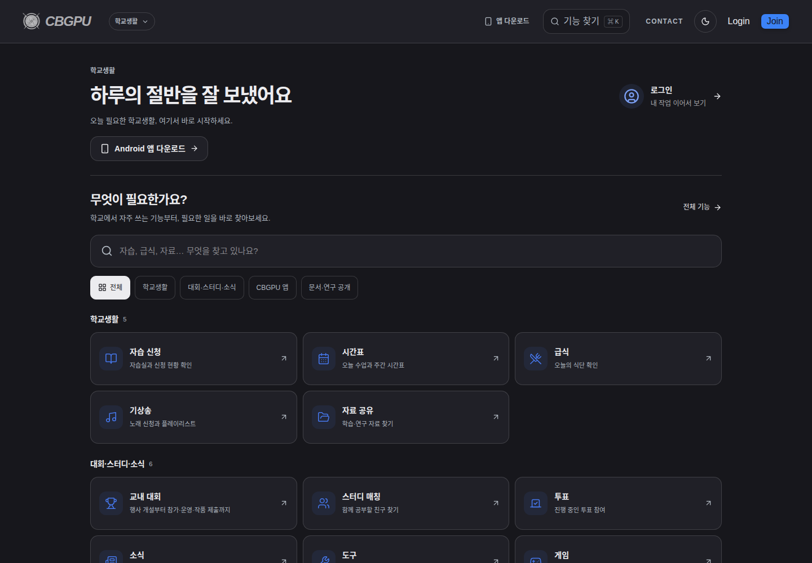
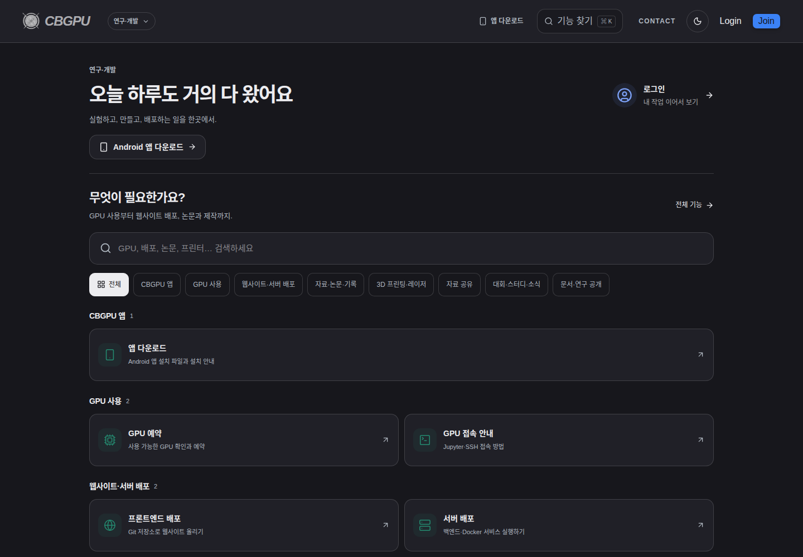
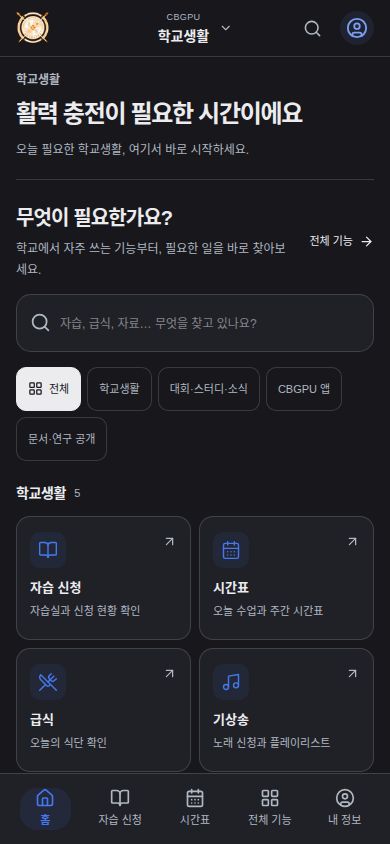

# CBGPU Web

[](https://github.com/CBGPU-Engineering/CBGPU-web/actions/workflows/ci.yml)
[](https://nextjs.org)
[](https://react.dev)
[](LICENSE)


The student and research & development web application for CBGPU, including the
mobile web interface, public documentation, preprints and web-facing API routes.
The Flutter shell is in [CBGPU-app](https://github.com/CBGPU-Engineering/CBGPU-app); database and infrastructure
services are in [CBGPU-backend](https://github.com/CBGPU-Engineering/CBGPU-backend).

## Screenshots





<details>
<summary>Screenshot sources</summary>

### Capture details

Captured from the running HTTPS sites on November 4, 2026, signed out and using
the browser's dark color preference. No private account, session or operator
information is included.

| File | Source | Viewport |
| ---- | ------ | -------- |
| `home.png` | `https://cbgpu.com/` | 1440 × 1000 |
| `student.png` | `https://student.cbgpu.com/` | 1440 × 1000 |
| `research.png` | `https://researcher.cbgpu.com/` | 1440 × 1000 |
| `app-mobile.png` | `https://app.cbgpu.com/?mode=student` | 390 × 844 |
| `services.png` | `https://student.cbgpu.com/services` | 1440 × 1000 |
| `docs.png` | `https://docs.cbgpu.com/` | 1440 × 1000 |
| `arxiv.png` | `https://arxiv.cbgpu.com/` | 1440 × 1000 |
| `developers-signin.png` | `https://developers.cbgpu.com/` | 1440 × 1000 |

The mobile image is a mobile browser capture, not a physical-device screenshot.
Greetings, service listings and public paper counts may change after capture.

</details>

## Local demo

Use Node.js 22.18+ and npm. No school account, GPU, database or service keys are needed.

```bash
git clone https://github.com/CBGPU-Engineering/CBGPU-web.git
cd CBGPU-web
npm ci
npm run demo
```

Open http://localhost:3100. Use `student@example.invalid` or
`researcher@example.invalid`, password `demo-only`. EduSet and GPU data are
synthetic and unsupported integrations are never forwarded to production.

```bash
npm test
npm run build:demo
npm run start:demo
```

For a real isolated backend, configure `.env.local` from `.env.example` and use
`npm run dev`. A production build uses `npm run build` with your environment.
See [development](docs/DEVELOPMENT.md) and [contributing](CONTRIBUTING.md).
SQL migrations and database test fixtures belong to the [backend schema](https://github.com/CBGPU-Engineering/CBGPU-backend/tree/main/schema). This repository contains no SQL. Runtime and school-integration setup belong to the backend configuration and operations guides.

## Platform integration

[CBGPU-platform](https://github.com/CBGPU-Engineering/CBGPU-platform) pins this repository at
`FrontEnd/cbgpu` alongside the backend, app and resource services. Changes to this
component are reviewed here before the platform pin is updated.

## License

Original code is [Apache-2.0](LICENSE). See [NOTICE](NOTICE),
[third-party notices](THIRD_PARTY_NOTICES.md) and [security reporting](SECURITY.md).
Extracted from platform commit `f41d879f6b0a10192fa36235e370372a78ec7331`; original authors and relevant component history are preserved. The complete original repository history remains in CBGPU-platform.
