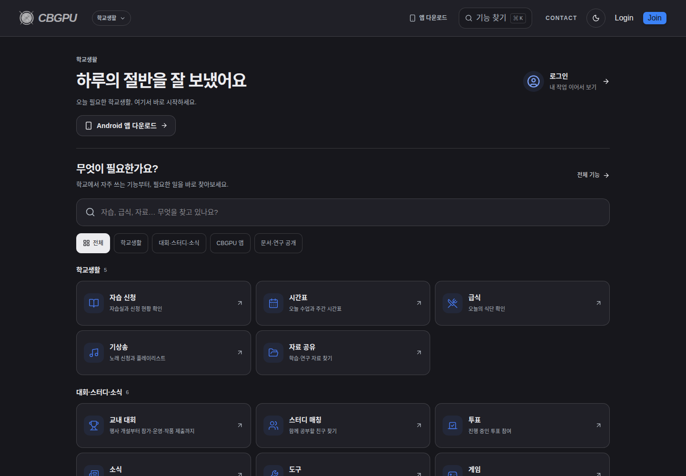
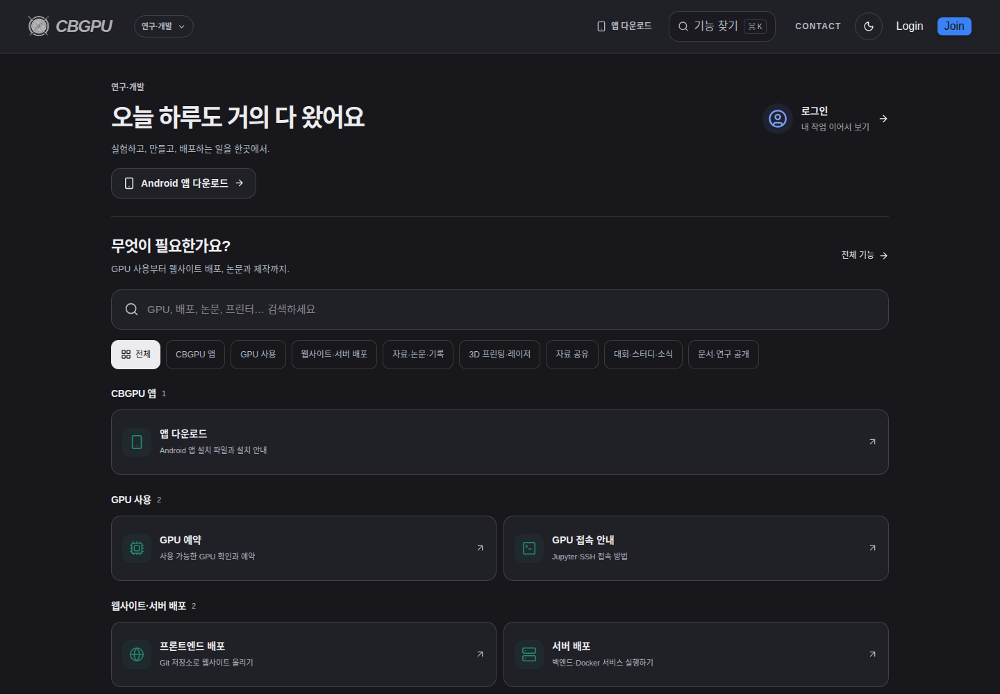
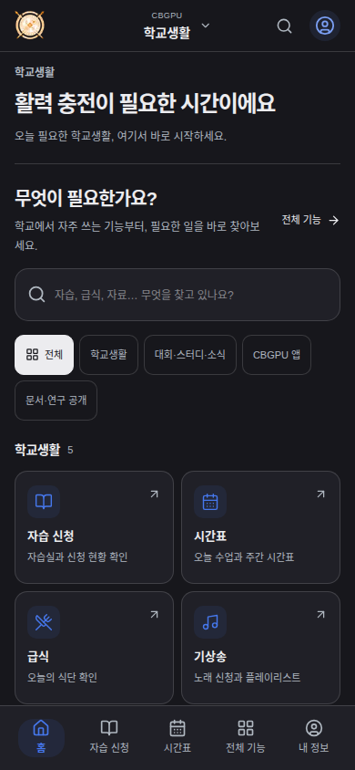

# CBGPU Web

[](https://github.com/CBGPU-Engineering/CBGPU-web/actions/workflows/ci.yml)
[](https://nextjs.org)
[](https://react.dev)
[](LICENSE)


The student and research & development web application for CBGPU, including the
mobile web interface, public documentation, preprints and web-facing API routes.
The Flutter shell is in [CBGPU-app](https://github.com/CBGPU-Engineering/CBGPU-app); database and infrastructure
services are in [CBGPU-backend](https://github.com/CBGPU-Engineering/CBGPU-backend).

## Screenshots





More captures and their source URLs are in [docs/screenshots](docs/screenshots/README.md).

## Local demo

Use Node.js 22.18+ and npm. No school account, GPU, database or service keys are needed.

```bash
git clone https://github.com/CBGPU-Engineering/CBGPU-web.git
cd CBGPU-web
npm ci
npm run demo
```

Open http://localhost:3100. Use `student@example.invalid` or
`researcher@example.invalid`, password `demo-only`. EduSet and GPU data are
synthetic and unsupported integrations are never forwarded to production.

```bash
npm test
npm run build:demo
npm run start:demo
```

For a real isolated backend, configure `.env.local` from `.env.example` and use
`npm run dev`. A production build uses `npm run build` with your environment.
See [development](docs/DEVELOPMENT.md) and [contributing](CONTRIBUTING.md).
SQL migrations now belong to the backend repository; old migration collections
are retained there with provenance under `schema/legacy`.

## Platform integration

[CBGPU-platform](https://github.com/CBGPU-Engineering/CBGPU-platform) pins this repository at
`FrontEnd/cbgpu` alongside the backend, app and resource services. Changes to this
component are reviewed here before the platform pin is updated.

## License

Original code is [Apache-2.0](LICENSE). See [NOTICE](NOTICE),
[third-party notices](THIRD_PARTY_NOTICES.md) and [security reporting](SECURITY.md).
Original component commit history is preserved; see [migration details](docs/MIGRATION.md).
