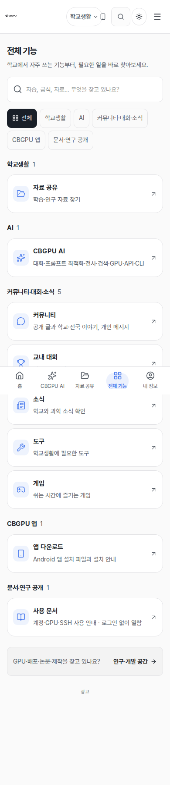
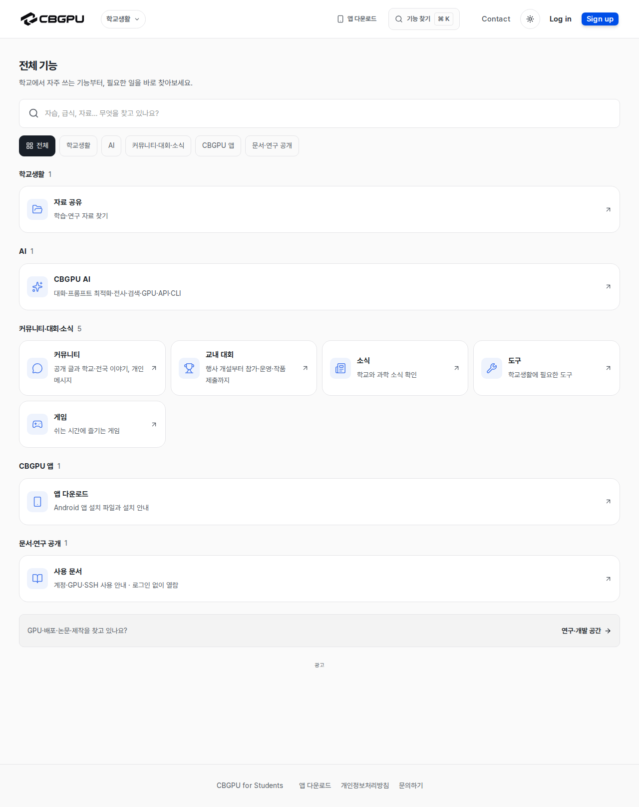
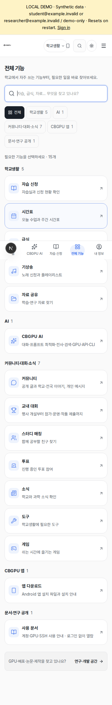
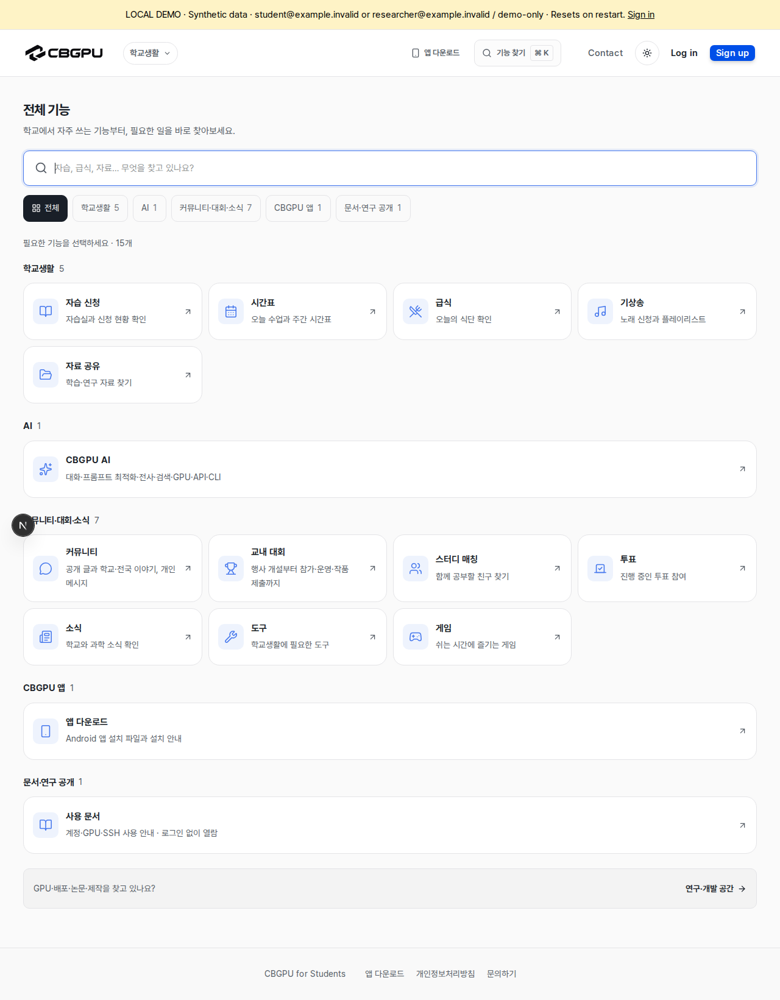

# Finding features and editing shortcuts

This change improves the existing home and service directory, including their app WebView presentation. It keeps authentication, school visibility, destinations, the shared navigation, advertising, and the everyday two-column phone grid intact.

## Findings and implementation

| Journey | Problem | Change | Rationale |
| --- | --- | --- | --- |
| Find a feature | A previously selected category could hide a matching feature. | Show matching counts in categories and offer a direct way to reveal matches in other categories without discarding the query. | Recognition over recall; clear error recovery. |
| Recover from a search | Clearing or resetting search could leave keyboard focus on a disappearing button. | Return focus to search after clear, reset, or category recovery. | Predictable focus and continued task context. |
| Start research work | Unlisted groups sorted with index `-1`, placing AI above GPU and deployment tools. | Give all existing groups an explicit order. | Match information hierarchy to the intended task order. |
| Customize shortcuts | Every selection immediately changed stored preferences; there was no cancel. | Edit a draft with explicit Save and Cancel; retain the draft if browser storage fails. Restore focus when the editor closes. | User control, error prevention and recovery. |
| Read and act on mobile | Home AI helper text and several targets were smaller than the product conventions. | Use readable 14px text, foreground contrast for selected shortcuts, and targets at least 44px high; retain responsive layout and reduced-motion support. | Readability and Fitts's law. |

The directory reuses the existing Motion spring for positional transitions. It does not animate essential controls out of reach or delay navigation. No dependencies were added.

## Verification

Run the existing unit and contract suite with `npm test`, application types with `npx tsc --noEmit`, and test/tooling types with `npm run check:tooling`.

Start the synthetic demo on ports 13911 and 13912, then run:

```bash
CBGPU_DEMO_PORT=13911 CBGPU_DEMO_API_PORT=13912 node scripts/demo.mts
# In a second terminal:
node tests/ux/discovery-browser.mts
```

The browser test refuses a non-loopback target and blocks external requests. It checks category recovery, clear/reset/Escape, focus, 44px controls, draft cancellation, persistence after saving, storage failure recovery, ordering, overflow, and JavaScript errors at 360, 390, 430 and 1280px. The loopback-only demo accepts `demo-frame=web` so both real desktop and app frames are exercised. Both themes and web/app user agents are exercised; light mode uses ordinary motion and dark mode uses reduced motion.

Screenshots below show the service directory. Before images are anonymous production pages; after images use the isolated synthetic demo and include its yellow diagnostic banner. That banner is not a product UI change. Screenshots are visual evidence, not measurements of conversion or task completion. Physical Android hardware, screen-reader behavior and real user task-completion improvements remain unverified.

| | Phone | Desktop |
| --- | --- | --- |
| Before |  |  |
| After |  |  |
